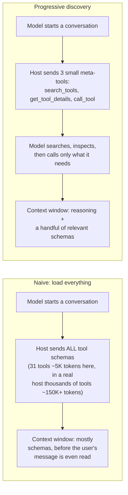
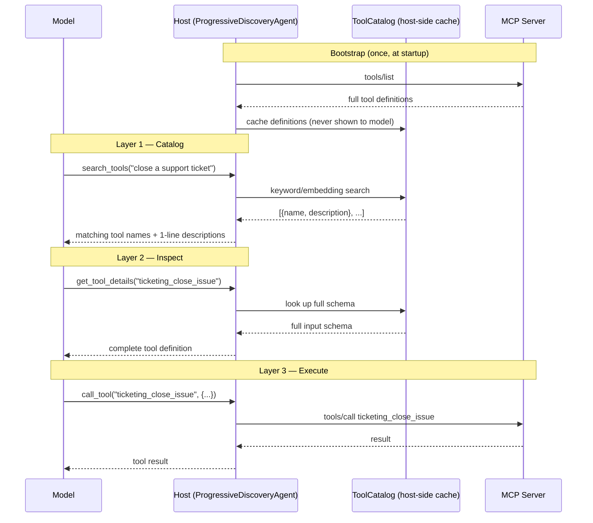
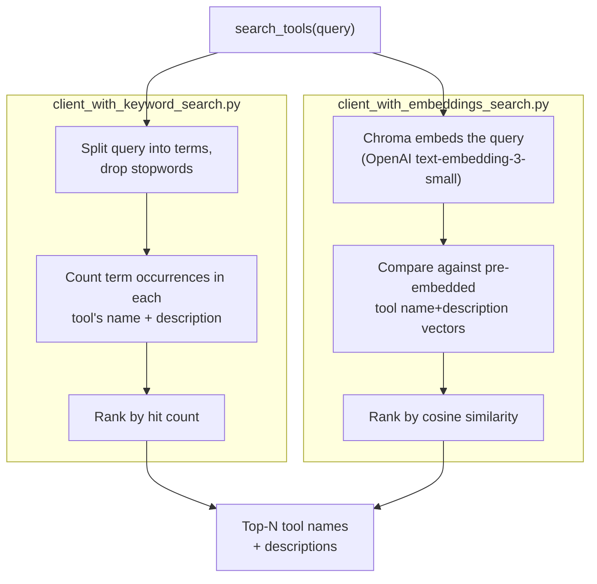
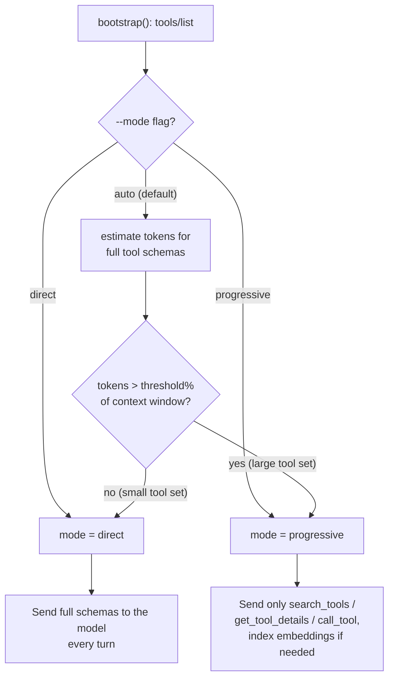
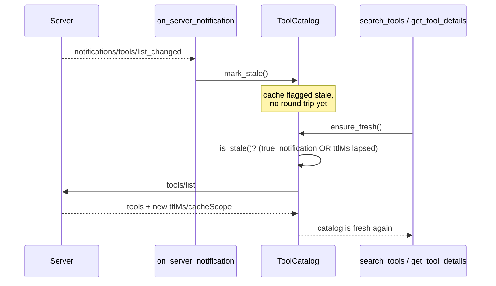

# Progressive Tool Discovery

A minimal, working implementation of the "progressive tool discovery" pattern
described in the MCP docs:
https://modelcontextprotocol.io/docs/2026-07-28/develop/clients/client-best-practices

## The idea

A naive MCP host sends every connected server's full tool schemas to the model
at the start of every conversation. That's fine for a handful of tools, but
once schemas eat a meaningful slice of the context window it wastes tokens,
adds latency, and hurts tool-selection accuracy.



Progressive discovery fixes this with a three-layer, search-based approach:

1. **Catalog** — the host calls `tools/list` as usual but keeps the full
   definitions host-side. The model is only given a lightweight
   `search_tools(query)` meta-tool that returns names + one-line descriptions.
2. **Inspect** — once the model picks a candidate, it calls
   `get_tool_details(name)` to fetch that one tool's full input schema.
3. **Execute** — the model calls `call_tool(name, arguments)`, which the host
   routes to the real MCP `tools/call`.



Because the array of tools handed to the model (`search_tools`,
`get_tool_details`, `call_tool`) never changes shape, this also keeps
prompt-caching on the tools prefix intact even as the real catalog grows.

## Layout

- `server.py` — a streamable-HTTP MCP server (`FastMCP`) exposing 31 tools
  across 11 fake domains (CRM, ticketing, virtual files, weather/math,
  inventory, billing, HR, analytics, notifications, calendar, project
  management) — enough that the full tool catalog alone is ~5K tokens
  (`ToolCatalog.full_definitions_token_estimate()`), comfortably past the 1%
  default threshold, so `--mode auto` picks `progressive` out of the box.
- `client_with_keyword_search.py` — the host/client using plain keyword
  matching as the Layer 1 search strategy. Connects over streamable HTTP,
  caches the tool catalog, decides direct-vs-progressive discovery, and
  drives an OpenAI chat completion loop.
- `client_with_embeddings_search.py` — the same host/client, but Layer 1
  indexes every tool's name+description into a local, in-memory Chroma
  (`chromadb`) collection instead of doing substring/keyword matching. Chroma
  calls OpenAI's embeddings API (`text-embedding-3-small`) under the hood via
  `OpenAIEmbeddingFunction` and handles vector storage + cosine-similarity
  search for `search_tools`. Catches semantic matches keyword search misses
  (e.g. "reach out to the customer" surfacing a CRM/email tool with none of
  those literal words in its description), at the cost of an embedding call
  per `search_tools` invocation (plus one batch call to index the catalog on
  startup).
- `client_langchain.py` — the same keyword-based `ToolCatalog` and
  mode-selection logic as `client_with_keyword_search.py`, but built on
  LangChain's agent framework (`langchain.agents.create_agent`) instead of a
  hand-rolled OpenAI chat-completions loop. Two things LangChain buys you
  here: in `direct` mode, `langchain_mcp_adapters.tools.load_mcp_tools`
  converts every real MCP tool schema into a LangChain tool in one call (no
  manual JSON-schema conversion); and in `progressive` mode, the three
  meta-tools are plain `@tool`-decorated async functions, with
  `create_agent` handling the tool-calling loop (executing tool calls,
  feeding results back to the model, looping until a final answer) instead
  of the manual `messages.append(...)` loop the raw OpenAI clients use. In
  `progressive` mode it also prints the *actual* total tokens used for the
  run (summed from each `AIMessage.usage_metadata` LangChain returns) — the
  real cost of the search → inspect → execute round trips, as opposed to the
  token *estimate* used only to decide direct-vs-progressive mode.

All three clients implement the identical catalog/inspect/execute meta-tool
contract and mode-selection logic — only the search strategy
(`ToolCatalog.search`) and the agent-driving framework differ. Diff the
files to see exactly what changes along each axis.



Keyword matching needs zero extra setup and is nearly free; embeddings catch
paraphrases and synonyms keyword search can't (e.g. "reach out to the
customer" → a CRM/ticketing tool with none of those literal words in its
description) at the cost of an embedding call per search and an indexing
step at startup.

## How the client decides discovery mode

On startup the client estimates the token cost of every tool's full JSON
schema (`ToolCatalog.full_definitions_token_estimate`) and compares it to a
configurable percentage of the model's context window
(`PROGRESSIVE_DISCOVERY_THRESHOLD_PCT`, default 1%, see the "When to Use
Progressive Discovery" section of the article). Below the threshold it falls
back to sending every tool schema directly (`mode=direct`); above it, it
switches to the search/inspect/execute meta-tools (`mode=progressive`).



You can also force the mode with `--mode direct` / `--mode progressive` to
compare behavior side by side — the demo server's 31 tools push the full
schema estimate to ~5K tokens (2.5% of a 200K-token window), past the 1%
default threshold, so `auto` now picks `progressive` out of the box. Pass
`--mode direct` explicitly to see the naive load-everything baseline instead.

The client also registers an MCP `message_handler` that marks the catalog
stale whenever the server sends `notifications/tools/list_changed`, per the
"Refresh on list_changed" guideline. For the embeddings client this rebuilds
the Chroma collection from scratch on the next refresh (simplest way to stay
correct even when tools are removed between refreshes).

## Caching (`ttlMs` / `cacheScope`)

The 2026-07-28 spec update adds `ttlMs` / `cacheScope` cache hints to
`tools/list` (and `prompts/list`, `resources/list`, `resources/read`,
`server/discover`) responses. `server.py` attaches these via the standard
`_meta` extension field (the Python SDK doesn't model them as first-class
fields yet):

```python
@mcp._mcp_server.list_tools()
async def _list_tools_with_cache_hints() -> types.ListToolsResult:
    tools = await mcp.list_tools()
    return types.ListToolsResult(
        tools=tools,
        _meta={"ttlMs": TOOLS_LIST_TTL_MS, "cacheScope": TOOLS_LIST_CACHE_SCOPE},
    )
```

Each client's `ToolCatalog` honors these hints instead of inventing its own
cache policy:

- `refresh()` records `ttlMs`/`cacheScope` from the response's `_meta` along
  with a fetch timestamp.
- `is_stale()` returns true once the TTL lapses.
- `mark_stale()` is called from the `list_changed` notification handler --
  per the caching guideline, a cache is treated as stale *immediately* on
  that notification, even if the TTL hasn't expired yet.
- `ensure_fresh()` is the lazy re-fetch: it's called right before
  `search_tools`/`get_tool_details` touch the catalog, and only does a real
  `tools/list` round trip if `is_stale()` is true. This replaced the old
  behavior of eagerly re-fetching inside the notification handler itself.



## Setup

```bash
cd progressive_tool_discovery
python3 -m venv .venv
source .venv/bin/activate
pip install -r requirements.txt
cp .env.example .env   # then fill in OPENAI_API_KEY
```

## Run

Terminal 1 — start the server (listens on `http://127.0.0.1:8300/mcp`):

```bash
python server.py
```

Terminal 2 — run any client (same CLI shape for all three; `query` is optional
and falls back to a sensible default, handy for running via the IDE's
play/debug button without typing arguments):

```bash
# keyword search (with no args, uses the default query below)
python client_with_keyword_search.py
python client_with_keyword_search.py "search for the contact jane, and if she doesn't exist create one"
python client_with_keyword_search.py --mode progressive "close ISSUE-1 with resolution 'fixed'"
python client_with_keyword_search.py --mode direct "what's the weather in Paris?"

# embeddings search
python client_with_embeddings_search.py "reach out to the customer about their open ticket"
python client_with_embeddings_search.py --mode progressive "close ISSUE-1 with resolution 'fixed'"
python client_with_embeddings_search.py --mode direct "what's the weather in Paris?"

# LangChain (create_agent), keyword search under the hood
python client_langchain.py
python client_langchain.py --mode progressive "close ISSUE-1 with resolution 'fixed'"
python client_langchain.py --mode direct "what's the weather in Paris?"
```

With 31 tools (~5K tokens of full schemas), `--mode auto` (the default) now
picks `progressive` for all three clients — pass `--mode direct` explicitly
to see the naive load-everything baseline, or try the "reach out to the
customer..." query above with the embeddings client to see where keyword
matching comes up empty but embeddings still finds `crm_search_contacts` /
`ticketing_create_issue`.

Every client prints `Total tokens used this run: N` after the final answer —
the actual token usage the model API reported (summed across every LLM call
in the run), in both `direct` and `progressive` mode. This is the real cost,
not the `full_definitions_token_estimate()` figure logged during mode
selection (which only estimates the cost of the full tool schemas, purely to
decide which mode to use). Compare the printed total between `--mode direct`
and `--mode progressive` on the same query to see the actual token savings.

## What's intentionally simplified

- **Search strategy**: only keyword and embedding-based are implemented here.
  The article also covers subagent-based and hybrid strategies — a natural
  next variant would be `client_with_subagent_search.py`.
- **Agent framework**: `client_langchain.py` is the only non-raw-SDK variant.
  A `client_langgraph.py` built directly on a custom `StateGraph` (rather
  than `langchain.agents.create_agent`'s prebuilt graph) would be a natural
  next variant for showing more manual control over the tool-calling loop.
- **Single server, single process** — no dynamic server connect/disconnect,
  and no use of the 2026-07-28 spec's `server/discover` RPC (the "Dynamic
  Server Management" section of the article). The catalog layer here
  operates at the tool level within one already-connected server; a
  `client_with_dynamic_servers.py` variant with a small server registry and
  `enable_server`/`disable_server` meta-tools would be a natural next
  variant for showing server-level progressive discovery.
- **No programmatic tool calling / sandboxing** — this lab covers progressive
  discovery only, not the "code mode" pattern from the same article.
